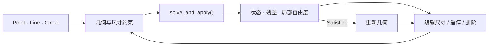

# MoonBit CAD Sketch

**Pure MoonBit 2D parametric sketch constraint solver.** 定义点、线和圆，添加几何与尺寸约束，求解草图；修改尺寸后再次求解。

[](https://mooncakes.io/docs/mik1e80/cad_sketch)
[](https://github.com/mik1e80/moonbit-cad-sketch/actions/workflows/ci.yml)
[](LICENSE)

## Why?

用距离、方向、对称和相切关系表达设计意图，让孔位、板边和连杆在尺寸变化后一起更新。适用于小型参数化零件草图、草图编辑器集成和平面机构教学。应用通过几何对象和关系建模，库负责联合求解，并报告哪些关系尚未达标。

**使用流程**：创建 `Sketch` → 添加点、线、圆 → 添加设计关系 → `solve_and_apply()` → 读取坐标、半径与报告 → 修改尺寸约束 → 再次求解。应用负责界面和文件处理，库负责草图几何的联动求解。

| 输入 | 库的处理 | 输出 |
| --- | --- | --- |
| 点、线、圆的初始位置，以及距离、方向、对称、相切等关系 | 把启用关系转为方程，联合求解，并按容差检查结果 | 候选坐标、半径、求解状态和逐约束诊断；全部达标才更新草图 |

普通使用者通过几何与约束 API 建模，无需自行编写方程或导数。详细处理机制见[内部实现](docs/ARCHITECTURE.md#处理流程)。

## Quick Start

在自己的 MoonBit 项目根目录安装：

```sh
moon add mik1e80/cad_sketch
```

在使用方的 `moon.pkg` 导入核心包：

```moonbit
import {
  "mik1e80/cad_sketch" @sketch,
}
```

建立一条水平线段，固定起点并设置长度：

```moonbit
let sketch = @sketch.Sketch::new()
let a = sketch.add_point(0.0, 0.0)
let b = sketch.add_point(3.0, 0.5)
sketch.constrain(Fix(a, 0.0, 0.0)) |> ignore
sketch.constrain(Horizontal(sketch.add_line(a, b))) |> ignore
let length = sketch.constrain(Distance(a, b, 5.0))

match sketch.solve_and_apply() {
  Ok(solution) => println(solution.report.is_satisfied())
  Err(error) => println(error.message())
}
```

`Ok` 表示求解返回了候选结果，是否达标仍需检查 `is_satisfied()`。此例达标后可用 `sketch.point(b)` 读取 B，接近 (5,0)。完整可运行程序见[快速开始](docs/QUICK_START.md#第一个草图)；[README.mbt.md](README.mbt.md)提供可执行公开接口示例。

| 操作 | 设计输入 | 达标后的几何（近似值） |
| --- | --- | --- |
| 第一次求解 | A 初值 (0,0)、B 初值 (3,0.5)；固定 A、AB 水平、长度 5 | A=(0,0)、B=(5,0) |
| 修改尺寸后再求解 | 仅把同一长度约束 5→7，不直接修改 B 坐标 | A=(0,0)、B=(7,0) |

坐标为容差内的近似解，不要求浮点输出逐字相同。下文 [Parametric Editing](#parametric-editing) 展示第二步的代码。

## Visual Example

同一份四孔安装板草图，将板宽 120→160、孔半径 5→8、水平孔心边距 20→30。四孔位置由镜像、等半径和边距关系共同求解，编辑时只修改尺寸约束。

| 修改尺寸前 | 修改尺寸后 |
| --- | --- |
|  |  |

<details>
<summary>冲突阶段：保存几何保持不变</summary>


</details>

```sh
moon run examples/parametric_bracket --target js
```

[安装板案例](examples/parametric_bracket/README.md)展示尺寸联动，以及冲突编辑后的几何保留与恢复。以上三份 SVG 由核心库的 `sketch.to_svg()` 直接返回，同一视野、同一比例。[SVG 导出说明](docs/SVG_EXPORT.md)包含接口与生成命令；此接口已包含在 Mooncakes 0.2.2 正式版本中。

## Features

- **草图建模**：点、线、圆与草图内实体句柄。
- **设计关系**：24 种几何和尺寸约束，默认选项即可求解。
- **参数编辑**：修改尺寸、启停或永久删除约束，再次求解。
- **结果应用**：只有全部启用关系达标时，`solve_and_apply()` 才写回几何。
- **诊断**：类型化错误、状态、逐约束残差和局部自由度。
- **SVG 输出**：`Sketch::to_svg()` 导出当前草图，支持自动适配或使用共享视野。
- **运行时**：纯 MoonBit，仅依赖 MoonBit core；支持 wasm、wasm-gc、JS 和 native。

<details>
<summary>查看建模、编辑与求解能力图</summary>



</details>

## Supported Constraints

| 类别 | 关系 |
| --- | --- |
| 定位与对称 | 固定、重合、中心对称、轴对称 |
| 尺寸与方向 | 距离、X/Y 距离、点线距离、半径、水平、竖直、平行、垂直、夹角 |
| 线关系 | 等长、长度比例、中点、点在线上 |
| 圆与相切 | 同心、等半径、点在圆上、线圆相切、圆圆内切与外切 |

共 24 种关系。长度沿用调用者统一单位，角度使用弧度。构造器、方向与定义域见[约束参考](docs/CONSTRAINTS.md)。

## Parametric Editing

继续使用 Quick Start 中的草图与尺寸句柄，把线段长度从 5 改为 7：

```moonbit
if sketch.set_constraint(length, Distance(a, b, 7.0)) {
  match sketch.solve_and_apply() {
    Ok(updated) => println(updated.report.is_satisfied())
    Err(error) => println(error.message())
  }
}
```

`set_constraint_enabled(id,false)` 临时关闭关系；`remove_constraint(id)` 永久删除。编号保持稳定，删除后不复用。`set_point()` / `set_radius()` 修改初值，驱动设计尺寸应修改对应约束。[编辑流程与生命周期](docs/CONSTRAINT_LIFECYCLE.md)说明完整语义。

## Diagnostics

| 返回结果 | 下一步 |
| --- | --- |
| `Err(error)` | 按 `SketchError` 变体匹配并修正输入；`error.message()` 用于日志 |
| `Ok`，状态为 `Satisfied` | 读取结果；`solve_and_apply()` 已更新保存几何 |
| `Ok`，状态为 `Stalled` / `IterationLimit` | 检查候选结果与报告；保存几何保持不变 |

`report.likely_conflicts()` 按误差比排序启用且超标的关系，帮助决定检查顺序。`local_dof` 是一阶局部估计。未收敛不证明无解，排序列表也不是最小冲突集。处理方式见[错误与诊断](docs/DIAGNOSTICS.md)及[求解与结果](docs/SOLVER.md)。

## Examples

在源码仓库根目录运行，所有案例均使用核心库公开接口：

| 案例 | 命令 | 展示内容 |
| --- | --- | --- |
| [basic](examples/basic/README.md) | `moon run examples/basic --target js` | 矩形改宽、三角形、相切圆 |
| [parametric_bracket](examples/parametric_bracket/README.md) | `moon run examples/parametric_bracket --target js` | 四孔安装板尺寸联动 |
| [mirror_holes](examples/mirror_holes/README.md) | `moon run examples/mirror_holes --target js` | 镜像孔位与轴移动 |
| [four_bar](examples/four_bar/README.md) | `moon run examples/four_bar --target js` | 同一机构连续改变驱动角度 |
| [conflict](examples/conflict/README.md) | `moon run examples/conflict --target js` | 诊断、几何保留、停用与删除恢复 |

四杆机构固定 A、D，保持 AB=30、BC=70、CD=50，以 15° 步长往返求解 25 个姿态：


[全部示例](examples/README.md)包含参数、预期行为与复现说明。

## Validation

| 验证证据 | 已保存的范围与结果 |
| --- | --- |
| [Validation Suite](docs/VALIDATION.md) | 六组 400 个生成配置，四后端分别独立检查 |
| [随机初值实验](docs/RANDOM_TRIANGLE.md) | JS 的 1000 个三角形初值，记录全部状态与独立边长检查 |
| [SciPy 开发对照](docs/SCIPY_REFERENCE.md) | 500 个同输入配置，对比坐标、半径和残差 |
| [Consumer Test](docs/CONSUMER_TEST.md) | 仓库外 `moon new → moon add → moon test → moon run`，三个消费测试、SVG XML 校验及程序运行通过 |

**核心实现最近一次完整回归对应 `v0.2.1`，结果通过**：[实际 Actions](https://github.com/mik1e80/moonbit-cad-sketch/actions/runs/39787171206)固定到提交 `458d5f3`。四后端各 107 项测试、各 400 个生成配置，以及 JS 的 1000 个随机初值全部通过；解包后的完整检查四后端各 112 项通过。[版本验证摘要](docs/releases/0.2.1-full-regression.json)保留范围、源码指纹及原始产物地址。

历史快照保留原始测量；本次完整结果单独保存，未重测 SciPy 对照或四档计时。日常仍只需运行七项公开接口示例：

```sh
moon test README.mbt.md --target js
```

## Performance

以下为已保存的 JS release 历史测量，使用相同的相连三角化折线模型；每档预热一次、测量三次。展示规模、迭代和独立残差：

| Case | Points | Vars | Constraints | Iterations | Satisfied | 最大长度残差 |
| --- | ---: | ---: | ---: | ---: | ---: | ---: |
| Small | 10 | 20 | 20 | 4 | 3/3 | 7.77e-10 |
| Medium | 30 | 60 | 60 | 6 | 3/3 | 1.18e-08 |
| Large | 60 | 120 | 120 | 8 | 3/3 | 5.49e-09 |
| Stress | 100 | 200 | 200 | 8 | 3/3 | 7.17e-08 |

这些固定模型结果不代表任意同规模草图的成功率或跨电脑性能。[Benchmark 方法、机器环境及原始数据](docs/BENCHMARK.md)保留完整条件；轻量复现可用 `node scripts/benchmark.cjs --smoke --target js`。

## Comparison with MoonBit Ecosystem

本库提供几何对象、设计关系、参数编辑和联合草图求解。与已核对版本的相关项目分工如下：

本项目的输入是**草图对象与设计关系**，输出是**求解后的几何与诊断**。核心库仅依赖 MoonBit core；网格修复或 DXF 文件处理属于其他组件的职责，不计入本项目已交付能力。具体边界见[项目定位](docs/POSITIONING.md#输入输出与组件边界)。

| 方向 | 相关项目 | 本库的重点 |
| --- | --- | --- |
| 通用优化、几何算法 | MoonCurveFit、Moon Geometry | 直接用草图关系建模，管理对象、约束和编辑流程 |
| 线性布局、离散约束 | MoonCassowary、moonbit-constraint | 连续坐标与半径上的非线性几何等式 |
| CAD 应用、文件交换 | SolveSpace、moonbit-step、dxfkit | 小型纯 MoonBit 二维草图求解组件 |

公开接口证据、具体能力差异及集成边界见[生态对比](docs/ECOSYSTEM.md)。这里没有跨库性能或收敛率排名。

## Architecture

建模层管理几何与关系；求解层计算候选坐标和半径，再返回报告。使用者通过 `Sketch`、`Constraint`、`Solution` 和 `SolveReport` 完成日常流程。

高级数值设置与算法细节集中在[内部实现](docs/ARCHITECTURE.md)。专题入口：[快速开始](docs/QUICK_START.md)、[约束](docs/CONSTRAINTS.md)、[求解](docs/SOLVER.md)、[诊断](docs/DIAGNOSTICS.md)、[限制](docs/LIMITATIONS.md)、[API 总览](docs/API_GUIDE.md)和[项目定位](docs/POSITIONING.md)。

## Limitations

面向小型草图：最多 256 个标量变量、512 条线和 512 条现存约束。当前几何类型为 Point、Line、Circle，关系为等式约束。非线性求解依赖初值，可能有多解、翻转或停滞。

尚未实现圆弧、样条、不等式、增量求解、全局搜索、几何对象删除、模型持久化或完整 CAD 编辑器；没有 DXF / STEP 自动互转。[完整限制](docs/LIMITATIONS.md)明确数值范围与未实现功能，[验收记录](docs/ACCEPTANCE.md)区分已交付证据和其他事项。

## Installation

[Mooncakes：mik1e80/cad_sketch@0.2.2](https://mooncakes.io/docs/mik1e80/cad_sketch)。需 `moonc >= 0.10.15`；本次使用 `moonc 0.10.17+d971670cd` 做轻量发布验证。[Windows 环境准备](docs/ENVIRONMENT.md)说明安装与标准库匹配检查。核心仅依赖 MoonBit core。Python、Node.js 和 SciPy 用于可选开发验证。

```sh
moon add mik1e80/cad_sketch
```

[源码仓库](https://github.com/mik1e80/moonbit-cad-sketch) · [源码开发与本地 workspace](docs/QUICK_START.md#安装与版本) · [发布记录](docs/PUBLISHING.md) · [版本说明](CHANGELOG.md)

## License

Apache-2.0，完整条款见 [LICENSE](LICENSE)。参考出处、许可证及使用范围见 [THIRD_PARTY_NOTICES.md](THIRD_PARTY_NOTICES.md)。
