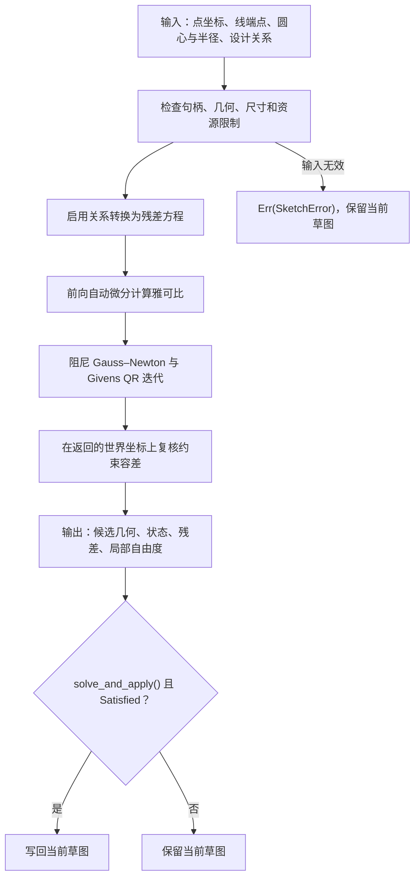

# 技术路径与质量边界

本文面向实现审查和高级调试。正常使用从 [API 指南](API_GUIDE.md)开始，默认选项不需要调用者提供方程、导数或矩阵。

## 处理流程

`solve()` 仅返回候选结果，不写回；`solve_and_apply()` 也只有在 `Satisfied` 时才写回。未达标的候选仍通过 `Ok(Solution)` 提供诊断，输入或数值错误则通过 `Err(SketchError)` 返回。调用者修改约束后重新执行同一流程；库不提供界面、文件导入或自动删约束策略。下面各节对应这一流程的实现与边界。

## 公开接口与内部实现

公开调用围绕 Geometry、Constraint、Solve、Edit、Diagnostic：`Sketch`、实体 / 约束句柄、关系构造器、`Solution` 和 `SolveReport`。草图身份、变量布局、归一化坐标、自动微分的 `Jet`、残差 `Row`、`Frame`、雅可比与线性求解函数均由库内部管理，不作为调用者必须组装的对象。

`SolveOptions` 和报告中的秩相关字段继续保留兼容性，属于可选高级设置与诊断。基本建模和重复编辑仅需默认 `solve_and_apply()`、状态 / 残差查询，无需配置数值秩。是否隐藏内部类型，以自动生成的 [pkg.generated.mbti](../pkg.generated.mbti) 为准。

## 输入如何成为方程

点贡献 x、y 两个变量；线复用端点，不增加变量；圆复用中心点并增加一个半径变量。实体句柄带有草图归属标识，禁止将另一份草图的同号对象作为本草图对象使用。单纯赋值 `let b = a` 共享同一个草图；创建独立草图需要 `Sketch::new()`。

约束表在 [model.mbt](../model.mbt)，方程在 [residual.mbt](../residual.mbt)。例如：

| 约束 | 残差 |
| --- | --- |
| 固定点 | `x-x_target`、`y-y_target` |
| 两点距离 | `hypot(dx,dy)-target`；零目标使用 `dx`、`dy` |
| 平行 / 垂直 | 单位方向向量的叉积 / 点积 |
| 有向夹角 | 把单位向量的叉积、点积旋转目标角，再用 atan2 得到主值误差 |
| 中心对称 | `a+b-2*center` 的两个分量 |
| 直线轴对称 | 单位轴方向与 `b-a` 的点积；单位轴方向与相对轴起点的两点中点的叉积。均为长度残差 |
| 带符号点线距离 | 单位线方向与点相对位置的叉积减去目标，左侧为正 |
| 长度比例 | `length(a)-ratio*length(b)` |
| 两圆外切 / 内切 | 圆心距减半径和 / 指定外圆半径减内圆半径 |

同一系统同时求解这些方程。所有启用的关系均须达到容差才报告成功，没有约束优先级或“尽量满足”的成功状态。Fix 也通过残差约束，并非符号消元后的精确常量。

## 约束生命周期与报告快照

`remove_constraint(id)` 物理移除关系、启停标记和句柄记录，不改动几何。现存关系存放于紧凑数组，约束 ID 单独按创建顺序递增，不随数组压缩改变，不复用已删除编号。查询、编辑、启停与删除先检查草图归属，再按稳定编号定位现存记录；当前模型最多接受 512 条现存关系，删除会释放名额，禁用不会。

求值内部的 `Row.slot` 只表示本次现存数组位置；对外残差与错误信息使用稳定的 `ConstraintId`。报告保留求解时的 ID 与误差，`report.residual(id)` 按 ID 查询而不是直接将 ID 当数组下标。删除后的新报告没有该项，旧报告仍描述历史状态，不能据旧报告假定关系目前仍存在。

以上查找与删除为 O(n)，没有引入稀疏增量求解。创建编号耗尽时中止，避免 Int32 溢出使旧句柄复活。完整边界与用例见 [约束生命周期](CONSTRAINT_LIFECYCLE.md)。

## 数值求解

默认长度容差为 1e-7、角度 / 方向容差为 1e-8、`rank_tolerance` 为 1e-9、最多 200 次迭代。秩阈值属于高级数值设置，用于局部自由度与方程相关性的估计；使用者通常不必调整。方向残差使用单位向量叉积 / 点积，角度误差使用弧度，分别按对应容差判断。

允许的秩阈值范围是 [1e-14,0.01]。求解结束后，库直接以返回的世界坐标重新计算全部残差，不以再次归一化后的坐标决定达标，避免相消掩盖容差违例；点线距离先归一化线方向再做叉积，降低极端长度下的溢出 / 下溢风险。这些步骤由内部实现管理。

1. [validate.mbt](../validate.mbt) 检查句柄、有限数、尺寸范围和资源限制。禁用关系保留编号，但不参与方程、尺度计算或关系校验；几何本身仍须有效。
2. 将坐标相对首点平移，并按点跨度、半径与启用尺寸中的最大长度统一缩放。每个长度残差除以长度容差，方向 / 夹角残差除以各自容差，得到 r。
3. [autodiff.mbt](../autodiff.mbt) 用前向自动微分的链式法则产生雅可比 J，运算仍使用 Double。范数在零点不可微，代码选择零方向导数以避免除零，这类初值可能停滞；不能将该约定称为零点的真实导数。
4. [linalg.mbt](../linalg.mbt) 依据 J 的列范数构造缩放 D，并解 `min ||J*delta+r||² + lambda*||D*delta||²`。增广矩阵通过 Givens QR 求解；没有显式计算正规方程，避免进一步放大病态问题的条件数。
5. 候选几何合法且加权平方误差降低时接受该步并减小阻尼，否则增大阻尼重试。每轮最多 16 次尝试，默认最多 200 轮，最多允许 1000 轮。步长过小或不能降低误差时停止。
6. 输出坐标转换回原单位后，以这些实际坐标直接重新检查所有残差。不会仅凭内部归一化变量达标就报告成功。若最终坐标的误差超标，状态为未收敛；`solve_and_apply()` 不写入该结果。

相切可能有不同构型；有向角使用主值，存在分支边界。没有全局搜索或任意初值收敛保证。内部点线距离先归一化方向再叉乘，避免很小或很大尺寸的原始叉积发生下溢或溢出；仍不保证任意浮点尺度均可处理。

## 自由度与失败的含义

报告中的秩来自当前返回几何的雅可比：先按行最大系数缩放，再做完全选主元消元，使用调用者指定的数值阈值。`local_dof=变量数-rank`，`dependent_equations=方程数-rank`。

这是一阶估计。共线、相切等奇异构型可能有额外的一阶自由度，不能将数值秩当成全局刚性证明。重复关系也不必互相冲突。`unsatisfied()` 仅指出当前结果超标的关系，未证明哪一组关系最小冲突。未收敛既可能源自矛盾，也可能源自初值、构型、尺度或迭代预算。

阻尼不是“结果离初值最近”的目标函数。欠约束模型的自由方向可能漂移，定位需求应由关系表达。`Mirror(p,p,axis)` 仅要求点落在轴上，沿轴方向仍自由；轴方向反转同时反转两个残差的符号，不改变零点。该关系不对两点间距离做除法，所以可接受轴上重合点；轴长仍需通过统一退化检查。

## 失败诊断排序

`SolveReport::likely_conflicts()` 复用 `unsatisfied()` 的筛选规则（启用且 `tolerance_ratio > 1`），对新数组按误差比降序、稳定 ID 升序排序；不改动原始报告顺序或几何。误差比是每条关系的最大分量误差除以对应长度或角度容差，便于比较不同单位的残差。返回完整超标列表，不自动截断或删除约束。

该接口没有额外求解、逐项移除实验或一致性证明。误差大的项可能是其他关系影响下的症状，停滞也可能来自可解模型的奇异初值。它给出检查顺序，不代表用户应修改哪一项，也不改变所有启用约束必须达标的求解规则。历史报告仍按历史状态排序，诊断和边界详见[失败诊断](DIAGNOSTICS.md)。

## 如何验证

- 全部 24 种关系的自动微分与中心差分逐分量比较；关键方向和相切关系另有多构型比较。
- 坐标结果与解析几何比较，包括矩形、三角形、两圆交点、内外切和连续 21 个曲柄位置的四杆机构。
- 64 组三角形进行旋转、平移、缩放后与两圆交点公式对照，独立测量返回坐标的边长和锚点误差。
- 96 组大跨度、容差临界输入直接检查返回坐标，另测极小 / 极大尺寸的点线距离；这些是特定案例覆盖，不代表全域精度证明。
- 不同草图的点、线、圆、约束及结果句柄混用均有拒绝案例。
- `scripts/check_package.py` 解开真正的发布压缩包，检查许可和说明文件，再用独立消费模块在四后端编译测试；不需要提前发布到注册表。

批量验证另由 [Validation Suite](VALIDATION.md) 提供：公开接口生成六组共 400 个模型配置，独立 Node 检查器重算残差、解析坐标和构型分支，验证检查器自身能拒绝六类篡改，并在四后端输出逐案例数据。配置数与测试条目数分开统计；这项数据不外推到任意初值或大型草图。

可选的 [SciPy 参考对照](SCIPY_REFERENCE.md)通过开发目录中的 Python 独立实现残差，使用相同模型与初值比较坐标、半径和残差。开发工具从发布归档中排除，不被任何 MoonBit 包导入；参考优化器的终止状态不能替代独立残差判定。

## AI 协作与参赛者说明

本项目使用 AI 辅助接口、实现、测试和文档编写。参赛者需要理解上述变量建模、非线性迭代、容差单位、局部秩和失败语义，并能运行示例、解释初值选择及修改尺寸后的行为。本文提供技术说明，不替代参赛者掌握代码，也不表示已经通过赛事问答或验收。
