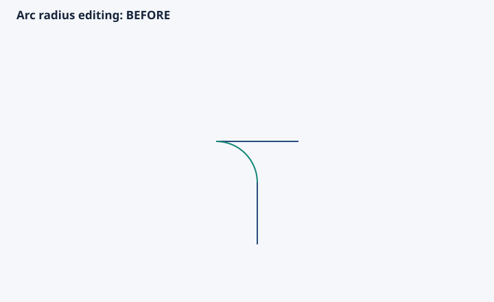
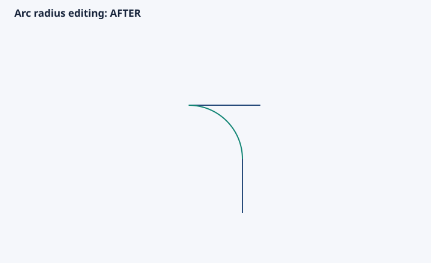
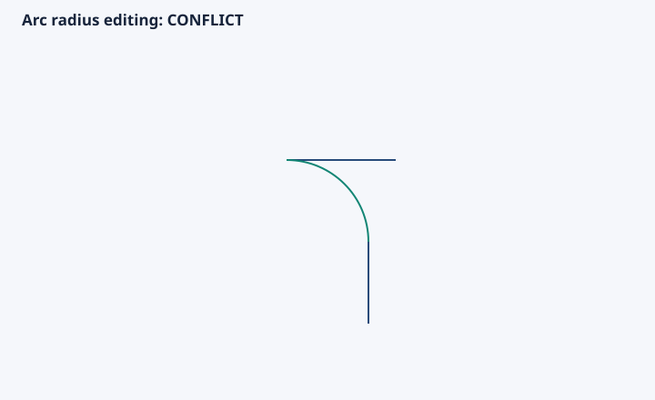

# 圆弧与线段联动

| 半径 2 | 半径 3 |
| --- | --- |
|  |  |

重新生成展示：`moon run scripts/completeness.mbtx --write-svg`；仅验证两个后端：`moon run scripts/completeness.mbtx showcase`。程序独立核对端点坐标，生成图形的文本不是跨平台逐位稳定协议。

在仓库根目录运行 `moon run examples/arc_fillet --target js`。

本例显式建立四分之一圆弧及两条共享端点的相切线段，将半径从 2 改为 3，独立核对端点坐标，再制造半径冲突，确认失败不会写回，删除冲突关系后恢复。构造轴参与求解但在 SVG 中隐藏。三份 SVG 均由核心 `to_svg()` 输出，同一视野及比例。

这是预先建模的圆弧连接案例，不是任意轮廓自动圆角、曲线修剪、GUI 或第三方生产集成。模型与代码为本项目自建，适用仓库 Apache-2.0；未采用 SolveSpace 模型、代码或截图。

输出中的 BEFORE_SVG、AFTER_SVG、CONFLICT_SVG 与 END_SVG 标记供宿主保存文件；SVG 导出不会执行求解。模型规范及数值分支限制见 [ARC_DESIGN](../../docs/ARC_DESIGN.md)。
